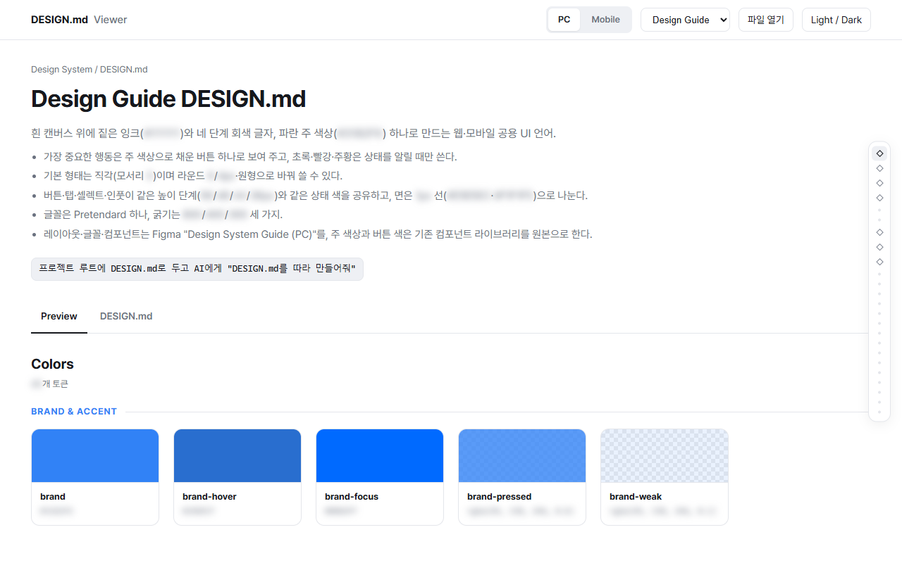
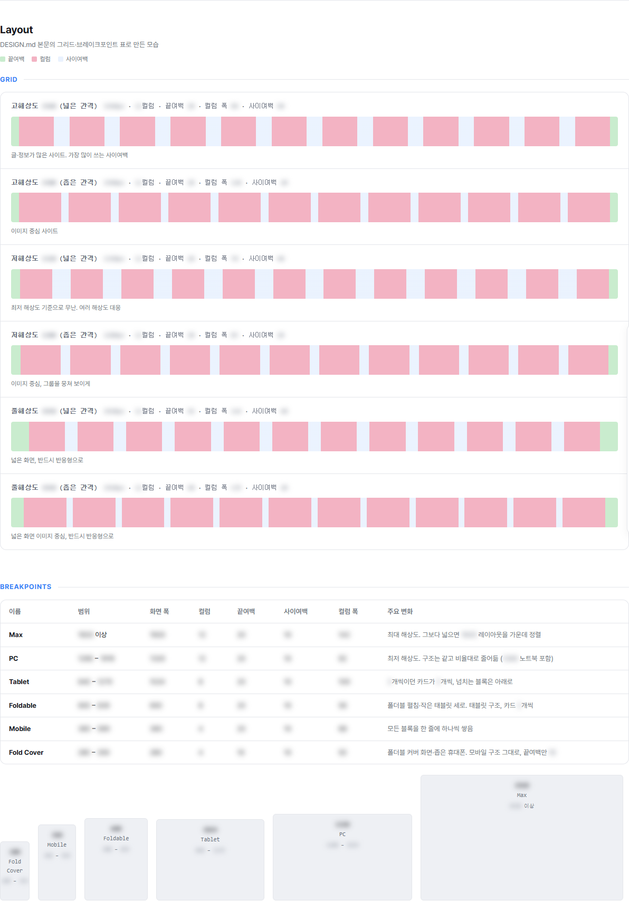
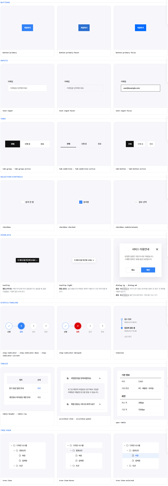
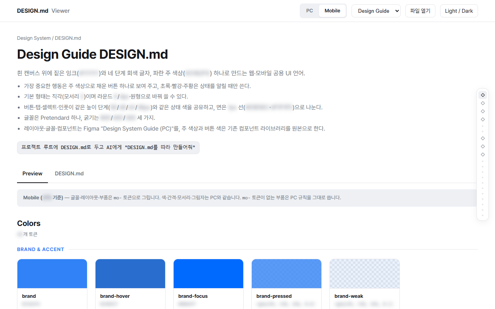
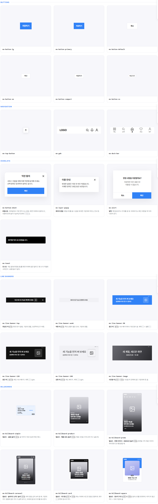

# Design Guide

웹·모바일·앱 어디에나 같은 규칙으로 쓰는 **디자인 시스템**입니다.
Figma **Design System Guide** PC·모바일 가이드를 바탕으로, AI와 개발자가 바로 읽을 수 있는 **DESIGN.md** 한 장으로 정리했습니다. PC와 모바일 규칙이 한 파일에 함께 들어 있습니다.

> 이 저장소는 소개용입니다. DESIGN.md 원본과 뷰어, Claude Code 플러그인은 비공개 저장소에 있습니다. 사용하려면 관리자에게 접근 권한을 요청하세요.

## 무엇이 들어 있나

- **토큰** — 색(주 색상·글자 4색·선·바탕·상태 색·시스템 팔레트), 타이포그래피(대표 문구·제목·소제목·본문·캡션·버튼, 모바일 포함), 간격 18단계, 모서리, 그림자
- **레이아웃** — PC 12컬럼 기본 그리드 6종, 적응형 그리드, 반응형 브레이크포인트(PC · 태블릿 · 폴더블 · 모바일 · 폴드 커버), 모바일 그리드와 해상도
- **컴포넌트 161개 (PC 122 + 모바일 39)** — 버튼, 입력창·검색창, 셀렉트·드롭다운, 날짜 선택, 탭, 체크박스·라디오·토글·옵션 카드, 배지·태그, 내비게이션, 사이드 메뉴, 팝업·얼럿·토스트·말풍선, 로딩, 단계 표시·타임라인, 테이블·FAQ·사양 표, 카드, 트리(체크박스·아이콘·연결선), 모바일 하단 독바·바텀시트·띠배너 6종·빌보드 7종, 빈 화면
- **사용 규칙** — 언제 어떤 값을 쓰는지, 해야 할 것과 하지 말아야 할 것, 반응형·접근성 기준
- **뷰어** — DESIGN.md를 실제 화면으로 그려 보여 주는 Preview와 원문 보기. 상단에서 PC / Mobile 화면을 전환
- **Claude Code 플러그인** — 화면 작업 시 AI가 이 디자인 시스템을 자동으로 따르게 함

## 화면

**Preview** — DESIGN.md의 토큰을 실제 색·글꼴·레이아웃·컴포넌트로 그린 모습

| 타이포그래피 | 레이아웃 (그리드 · 브레이크포인트) |
|---|---|
|  |  |

**컴포넌트 (PC)** — 버튼 · 입력창 · 탭 · 선택 · 팝업 · 단계 표시 · 테이블 · 트리

**Mobile** — 상단 전환 버튼으로 모바일 규칙(375 기준)을 같은 화면에서 봅니다

**컴포넌트 (Mobile)** — 버튼 · 내비게이션 · 팝업 · 띠배너 · 빌보드

